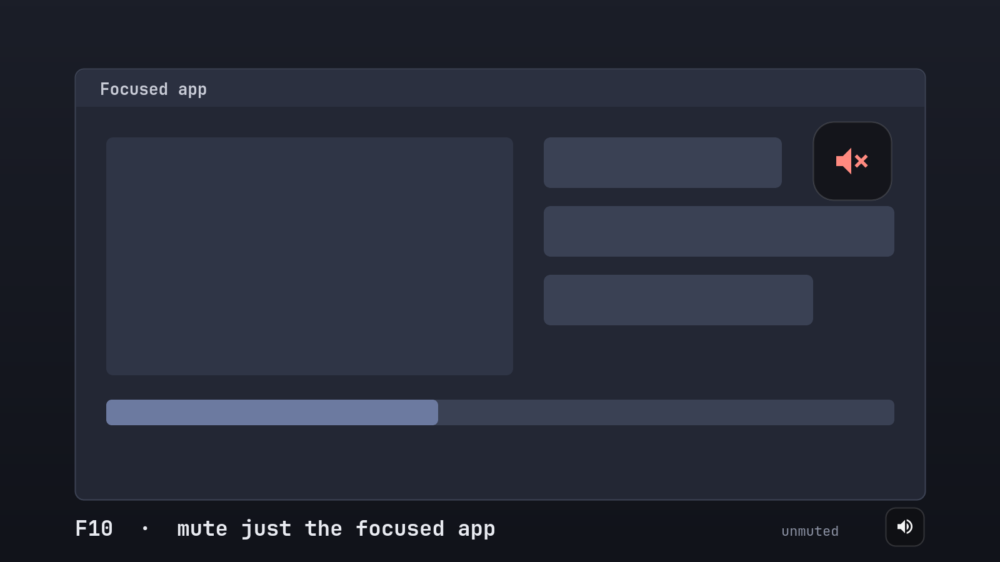

# F10 Mute

An Omarchy plugin: press **F10** to mute or unmute **only the app you're focused on**.

A small, translucent speaker badge appears on that app's window (in the corner you choose) and
fades out after about a second. It never takes keyboard focus or mouse clicks.



- Mutes just the focused app's playback, including audio from its child processes
  (browser audio services, Electron helpers, anything started from a terminal).
- Stays muted when the app opens new audio streams, which browsers and games do constantly.
- Mute state is saved on every change and restored after a shell restart, plugin reload or re-enable.
- Works in fullscreen games, on any monitor, at any scale.
- Turn it on and off from **Omarchy menu → Setup → Plugins**. While it's off, F10 reaches your apps normally.

## Requirements

| | |
|---|---|
| Omarchy | 4.x ("Quattro") with the Quickshell plugin system and Lua Hyprland config (`~/.config/hypr/hyprland.lua`) |
| Audio | PipeWire with `pipewire-pulse` (Omarchy's default), `pactl` with JSON output (libpulse 16+) |
| Tools | `hyprctl`, `pactl`, `ps` (procps): all present on a stock Omarchy install |
| Font | a Nerd Font for the badge glyphs (Omarchy's default JetBrainsMono Nerd Font works) |

Tested on Omarchy 4.5.0, Hyprland 0.56.2, Quickshell 0.3.2, PipeWire 1.6.9 and libpulse 17.

**Not supported:** Omarchy 3.x and older (Waybar, `hyprland.conf`) and Linux setups without Omarchy.
The plugin runs inside the Omarchy shell and its keybind uses Omarchy's Lua config helpers.

## Install

```bash
omarchy plugin add https://github.com/kaibur02/omarchy-f10-mute.git --enable
```

### Add the keybind (one-time)

Hyprland binds live in your Hyprland config, so the plugin asks before touching it. After you
enable the plugin, a notification offers **Add keybind**. Click it, or run:

```bash
bash ~/.config/omarchy/plugins/io.github.kaibur02.omarchy-f10-mute/setup-keybind.sh
```

This copies `hypr/f10mute.lua` to `~/.config/hypr/f10mute.lua`, adds one marked
`require("hypr.f10mute")` block to `~/.config/hypr/hyprland.lua` (with a timestamped backup first),
and reloads Hyprland. If Hyprland reports any config error, both files are restored automatically.

## Usage

- **F10** on any window toggles that app's audio and shows the badge.
- **Omarchy menu → Setup → Plugins → Disable Plugin → F10 Mute** turns it off. F10 then goes
  straight to your apps. Enable it again from the same menu.

Optional commands:

```bash
omarchy-shell f10mute toggle       # same as pressing F10
omarchy-shell f10mute preview      # show the badge on the focused window without toggling
omarchy-shell f10mute status       # settings + apps currently muted by F10 Mute
omarchy-shell f10mute unmuteAll    # unmute everything F10 Mute muted
```

## Configure

Badge settings live in `~/.config/f10mute/config.json`. Create it if you want to change anything;
edits apply live, with no restart.

```json
{
  "corner": "top-right",
  "margin": 24,
  "size": 64,
  "opacity": 0.7,
  "holdMs": 1000,
  "fadeMs": 400
}
```

| key       | default       | meaning |
|-----------|---------------|---------|
| `corner`  | `"top-right"` | `top-left`, `top-right`, `bottom-left`, `bottom-right` or `center` of the toggled window |
| `margin`  | `24`          | inset from the window's edges in logical px (shrinks on tiny windows) |
| `size`    | `64`          | badge size in logical px |
| `opacity` | `0.7`         | peak opacity of the badge |
| `holdMs`  | `1000`        | how long the badge stays fully visible |
| `fadeMs`  | `400`         | fade-out duration (no fade when Omarchy animations are off) |

**Different key:** edit `local KEY = "F10"` in `~/.config/hypr/f10mute.lua`, for example
`"SUPER + F10"`. Hyprland applies it on save, and `setup-keybind.sh` keeps your key when it updates the file.

## Remove

```bash
bash ~/.config/omarchy/plugins/io.github.kaibur02.omarchy-f10-mute/setup-keybind.sh --remove
```

```bash
omarchy plugin remove io.github.kaibur02.omarchy-f10-mute
```

The first command takes the keybind out of your Hyprland config (with a backup). If you skip it,
the leftover `~/.config/hypr/f10mute.lua` binds nothing once the plugin folder is gone.
Optionally delete `~/.config/f10mute/` (settings) and `~/.local/state/f10mute/` (saved mute state).

Disabling or removing the plugin leaves current mutes in place. They are ordinary stream mutes,
visible in any mixer. Run `omarchy-shell f10mute unmuteAll` first if you want everything unmuted.

## Is F10 a good key?

Hyprland and Omarchy don't use bare F10. While the plugin is enabled, apps don't receive **bare F10**;
Shift+F10, Ctrl+F10 and Alt+F10 still reach them.

| App | What F10 normally does | Impact |
|---|---|---|
| Firefox, Chromium, Brave | focuses the menu bar or app menu | negligible; Alt does the same |
| LibreOffice, GTK apps (Nautilus, …) | opens the menu bar or main menu | negligible; Alt works |
| `htop`, `mc` in a terminal | quit | use `q` instead, or change the key |
| Games | game-specific: some use F10 for a menu, quick-load, HUD or screenshot | rebind the game action, or change the key |
| VS Code, JetBrains IDEs, Visual Studio-style debuggers | **Step Over** | a real conflict if you debug; pick another key |

- The bind uses `dont_inhibit`, so it works in apps that grab every key (fullscreen games, VMs,
  remote desktop). Inside a VM or remote-desktop window, F10 mutes that local window instead of
  reaching the remote machine.
- Some keyboards send a media key on F10 unless Fn-lock is on. If F10 does nothing, check with `wev`.

## How it works

- **Which audio is the app's.** Each PipeWire playback stream is joined to its client to find the
  owning process. A stream belongs to the focused window if that process is the window's process or
  any descendant of it. Flatpak apps are matched by app ID against the window class. If the process
  tree finds nothing, name matching is used as a fallback.
- **Toggle rule.** If F10 Mute muted the app, the next press unmutes it. If every stream of the app
  is already muted (for example in pavucontrol), F10 unmutes it. Otherwise F10 mutes it. Muting an app
  that's silent right now pre-mutes it, so its next sound starts muted.
- **Saved state.** Muted apps are written to `~/.local/state/f10mute/state.json`, each with its
  process start time, so a PID reused by another process after a reboot is never mistaken for a muted
  app. On every start the plugin reconciles that file with what is actually playing.
- **WirePlumber guard.** WirePlumber remembers mute per application *name* and re-applies it to new
  streams with that name, which can leak a mute to another app sharing the name (many Electron apps
  report "Chromium", many games "FMOD"). F10 Mute undoes such a carried-over mute on streams that
  aren't from an app it is muting.
- **Keybind.** The bind is a normal, static entry in your Hyprland config. The plugin only flips a
  Lua flag (`_G.f10mute_enabled`) when it is enabled or disabled; it never creates or removes binds at
  runtime.
- **Badge.** A wlr-layer-shell surface on the overlay layer with no keyboard interactivity and an
  empty input region (clicks pass through). It is unmapped between toggles.

All work happens in one `sh` round trip per keypress (`hyprctl`, `pactl`, `ps`), about 60 ms.
No network access, no privileges, no background processes except `pactl subscribe` while something is muted.

## Limitations

- **One process, one mute.** Muting follows the process tree, not the window. Browsers run every
  window of a profile in one process, so F10 on any browser window mutes that whole browser instance,
  including its installed web apps.
- Only playback is muted; microphones are untouched.
- A muted app's brand-new stream can play for ~50–100 ms before it is muted. Usually WirePlumber
  restores the mute first and nothing is heard.
- If the Omarchy shell itself isn't running, F10 does nothing until it restarts.

## Development

```bash
node --test tests/                 # unit tests for logic.js
omarchy plugin validate .          # manifest check
```

`Service.qml` (shell service: muting, badge, state), `logic.js` (pure logic, unit-tested),
`hypr/f10mute.lua` (the keybind), `setup-keybind.sh` (adds or removes the keybind).

## License

MIT. See [LICENSE](LICENSE).
